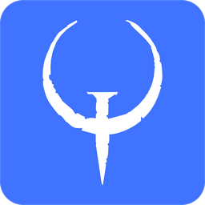

<p align="center">
  
</p>

<h1 align="center">ioquakelive</h1>

<p align="center">
  <a href="https://github.com/Splicho/ioquakelive/releases/latest"></a>
  <a href="https://github.com/Splicho/ioquakelive/releases"></a>
  <a href="https://github.com/Splicho/ioquakelive/actions/workflows/build.yml"></a>
  <a href="COPYING.txt"></a>
</p>

An open-source implementation of Quake Live, developed by the [Quake Club](https://quakeclub.com) team. It reproduces the last original version of the game (1069) on top of the [ioquake3](https://ioquake3.org/) engine, adding its own improvements while staying compatible with the original game.

The project builds on the work of [Thomas Jones](https://github.com/tjone270/ioquakelive), whose implementation served as the starting point and inspiration for further development.

## How to play

You will need a legitimate copy of [Quake Live](https://store.steampowered.com/app/282440/Quake_Live/). ioquakelive does not include the original game files, so it uses the ones from your own installation.

1. Download the latest version from [Releases](https://github.com/Splicho/ioquakelive/releases).
2. Extract the files wherever you prefer.
3. Run `ioquakelive.x86_64.exe` for the OpenGL renderer, or `ioquakelive-vulkan.x86_64.exe` if you prefer Vulkan.

There is no launcher: the engine starts directly and checks for, downloads and applies updates by itself, restarting the game when necessary.

On Windows, the game automatically detects your Quake Live installation and copies `pak00.pk3`. If automatic detection does not work, you can copy it manually into the `baseq3` folder.

## Building from source

The repository uses Git submodules (SDL3, curl, libogg, libvorbis, opus and opusfile), so fetch them first:

```bash
git submodule update --init --recursive
```

The launcher is no longer part of the project, so no CMake/Ninja setup is required for the game itself beyond building SDL3 below.

### Windows

Requirements:

- Visual Studio 2022 or later with the **Desktop development with C++** workload.
- Windows 10 or 11 SDK.

Run the commands from a **Developer PowerShell for Visual Studio**:

```powershell
# Visual Studio 2022 (v143 toolset)
msbuild misc\msvc\ioquakelive.sln /p:Configuration=Release /p:Platform=x64 /p:PlatformToolset=v143

# Visual Studio 2026 (v145 toolset, as used by CI)
msbuild misc\msvc\ioquakelive.sln /p:Configuration=Release /p:Platform=x64
```

The binaries are written to `build\Release\x64\`.

### Linux

Install the dependencies used by CI:

```bash
sudo apt-get update
sudo apt-get install -y build-essential cmake ninja-build \
  libfreetype-dev libogg-dev libvorbis-dev \
  libx11-dev libxext-dev libxrandr-dev libxcursor-dev libxfixes-dev libxi-dev \
  libxss-dev libxtst-dev libxkbcommon-dev libwayland-dev libdecor-0-dev \
  libegl1-mesa-dev libgl1-mesa-dev libgles2-mesa-dev libdrm-dev libgbm-dev \
  libasound2-dev libpulse-dev libpipewire-0.3-dev libdbus-1-dev libudev-dev libibus-1.0-dev
```

Build SDL3 from the submodule and then the game:

```bash
cmake -S code/SDL3 -B build/SDL3 -G Ninja -DCMAKE_BUILD_TYPE=Release \
  -DCMAKE_INSTALL_PREFIX="$PWD/sdl3-local" -DCMAKE_INSTALL_LIBDIR=lib \
  -DSDL_SHARED=ON -DSDL_STATIC=OFF -DSDL_TEST_LIBRARY=OFF
cmake --build build/SDL3
cmake --install build/SDL3

export PKG_CONFIG_PATH="$PWD/sdl3-local/lib/pkgconfig"
make release -j"$(nproc)"
```

The binaries are written to `build/release-linux-<arch>/`.

### macOS

```bash
brew install freetype libogg libvorbis

cmake -S code/SDL3 -B build/SDL3 -DCMAKE_BUILD_TYPE=Release \
  -DCMAKE_OSX_ARCHITECTURES=arm64 -DCMAKE_OSX_DEPLOYMENT_TARGET=11.0 \
  -DCMAKE_INSTALL_PREFIX="$PWD/sdl3-local" \
  -DSDL_SHARED=ON -DSDL_STATIC=OFF -DSDL_TEST_LIBRARY=OFF
cmake --build build/SDL3 -j"$(sysctl -n hw.logicalcpu)"
cmake --install build/SDL3

export PKG_CONFIG_PATH="$PWD/sdl3-local/lib/pkgconfig"
make release USE_LOCAL_HEADERS=0 ARCH=arm64 -j"$(sysctl -n hw.logicalcpu)"
```

The binaries are written to `build/release-darwin-arm64/`.

The exact commands used by CI, including packaging, are in [`.github/workflows/build.yml`](.github/workflows/build.yml).

## Features

- OpenGL, OpenGL 2 and Vulkan renderers, with NVIDIA Reflex and AMD Anti-Lag 2 support in Vulkan.
- Multi-threaded resource loading and uncapped FPS.
- Improved demo player.
- Quake Club integration.
- No launcher: direct startup and in-game updates.
- Bunch of QoL improvements, native quake 3 gore, cpma fullbright skins etc.
- New console commands: `help <command or cvar>` and `searchconsole`.

## If your antivirus blocks it

ioquakelive is a new project and does not have a digital signature yet, so its reputation on Windows is low and your browser or Microsoft Defender may flag it as suspicious. This tends to happen with every new version until more people download it. It is not a virus: the game is open source and every release is built on GitHub from this repository, so always download it from [Releases](https://github.com/Splicho/ioquakelive/releases).

1. If your browser blocks the download, choose "Keep".
2. If Windows shows "Windows protected your PC" when you open it, click "More info" and then "Run anyway".
3. If Microsoft Defender removes it, open Windows Security, go to "Protection history", select the warning and choose "Restore". To prevent it from happening again, add the game folder as an exclusion in "Virus & threat protection".

## Acknowledgements

- [scryd1ke](https://github.com/scryd1ke), for his code contributions.
- [mmranni](https://github.com/mmranni), for his testing and reports.

## Credits and license

This project also builds on the work of other developers and open-source projects:

- [ioquakelive by Thomas Jones](https://github.com/tjone270/ioquakelive)
- [ioquake3](https://github.com/ioquake/ioq3)
- [Quake3e](https://github.com/ec-/Quake3e)
- [CPMA](https://playmorepromode.com/)

Quake Live and its assets belong to id Software. The source code of this project is distributed under the GPL v2 license.
